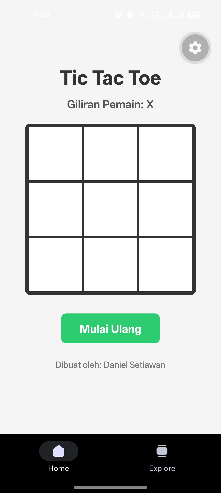
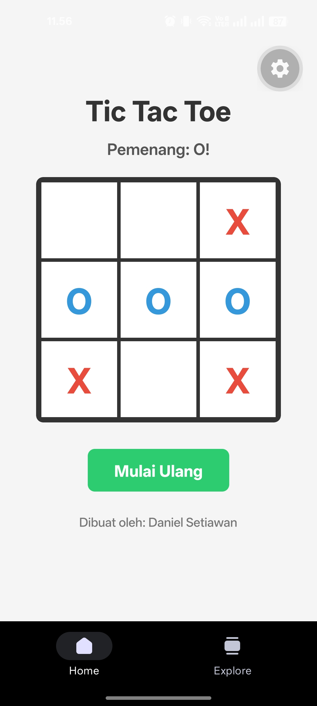
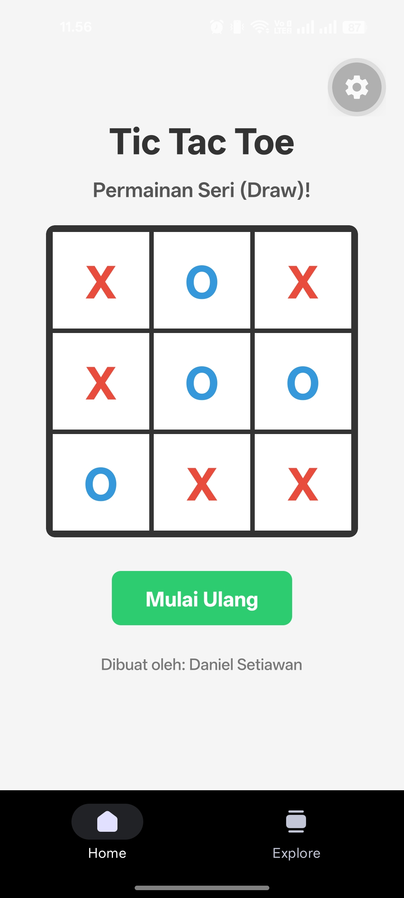

# Tic Tac Toe - React Native (Expo)

Permainan Tic Tac Toe dua pemain yang dibuat dengan React Native dan Expo sebagai tugas mata kuliah pemrograman mobile.

## Tampilan Aplikasi

<p align="center">
  
  
  
</p>

<p align="center">
  <em>Kiri ke kanan: permainan berlangsung, pemenang terdeteksi, dan permainan seri.</em>
</p>

## Fitur

- Papan permainan 3x3
- Dua pemain bergantian (X dan O)
- Deteksi pemenang otomatis (baris, kolom, dan diagonal)
- Deteksi permainan seri (draw)
- Tombol "Mulai Ulang" untuk mengatur ulang permainan

## Konsep yang Dipelajari

- **State management** dengan hook `useState`
- **Event handling** pada komponen `TouchableOpacity`
- **Immutability**: state papan diperbarui dengan spread operator (`[...board]`)
- **Flexbox layout** untuk menyusun papan 3x3
- **StyleSheet** untuk styling komponen

## Teknologi

- React Native
- Expo
- TypeScript

## Cara Menjalankan

Prasyarat: Node.js, npm, dan aplikasi **Expo Go** di HP (Android/iOS).

1. Clone repository:
   ```bash
   git clone https://github.com/danielsetiawan2403/TicTacToeApp.git
   cd TicTacToeApp
   ```
2. Install dependency:
   ```bash
   npm install
   ```
3. Jalankan development server:
   ```bash
   npx expo start
   ```
4. Scan QR code yang muncul di terminal menggunakan Expo Go. Pastikan HP dan laptop berada di jaringan Wi-Fi yang sama. Jika gagal tersambung, gunakan `npx expo start --tunnel`.

## Struktur Utama

```
src/app/index.tsx   # Kode utama permainan Tic Tac Toe
assets/screenshots/        # Gambar tampilan aplikasi untuk README
```

## Pembuat

Daniel Setiawan <br>
41155050240018